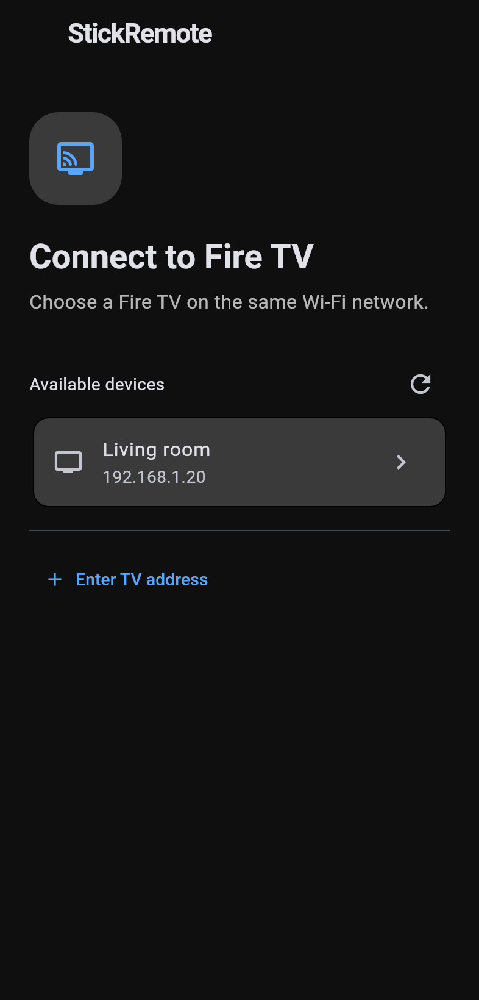
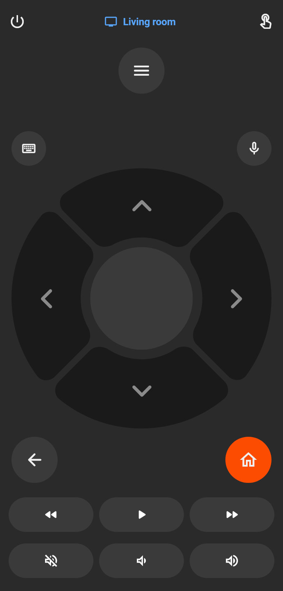
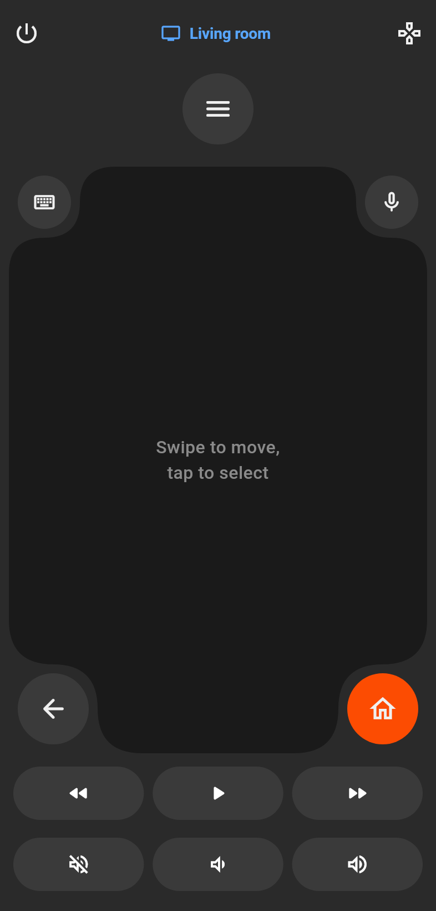
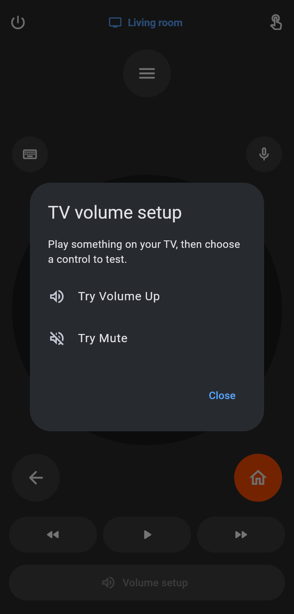

# StickRemote

Control your Fire TV over Wi-Fi without an Amazon sign-in.

[Download the latest Android APKs](https://github.com/bipinkrish/StickRemote/releases/latest)

Choose ARM64 for most Android phones, `armeabi-v7a` for a 32-bit ARM phone, or `x86_64` for an Intel or AMD emulator. Install one APK on your phone. This release requires Android 7.0 or later and uses the project's debug signing key.

## Pair your Fire TV

Open StickRemote on the same Wi-Fi as your Fire TV. Choose the device and enter the four digits shown on the TV. StickRemote stores the pairing token in Android Keystore-backed storage or the iOS Keychain. It reconnects when it discovers the last paired device.

The remote includes a directional pad, swipe pad, Back, Home, Menu, playback, keyboard input, push-to-talk, and TV volume, mute and power. Equipment controls depend on the receiver and its TV equipment setup.

## Screenshots

| Find a Fire TV | Directional pad |
| --- | --- |
|  |  |
| **Swipe pad** | **Volume setup** |
|  |  |

## Run from source

Use `flutter pub get`, then `flutter run` on a phone. The package and bundle identifier is `io.github.bipinkrish.stickremote`. Run `flutter test` for the simulated pairing and remote-control checks.

Build the split Android APKs with `bash tool/build_apks.sh`. The script writes `StickRemote-<version>-<abi>.apk` files to `build/releases/<version>/` using the Android build's version name.

On iOS, open the Runner workspace in Xcode and select your development team. Automatic SSDP discovery on a physical iPhone requires a provisioning profile with the multicast entitlement. The project declares it in `ios/Runner/Runner.entitlements`. Allow the Local Network prompt. If multicast is blocked on the Wi-Fi network, use **Enter TV address**. Find the address in the Fire TV network settings. [Apple’s local-network guidance](https://developer.apple.com/documentation/technotes/tn3179-understanding-local-network-privacy)

## Protocol

Discovery uses SSDP and DIAL. Pairing and commands use the receiver’s HTTPS Turnstile service, with its certificate trust anchor bundled in `assets/turnstile.der`. Voice uses a local encrypted WebSocket.
